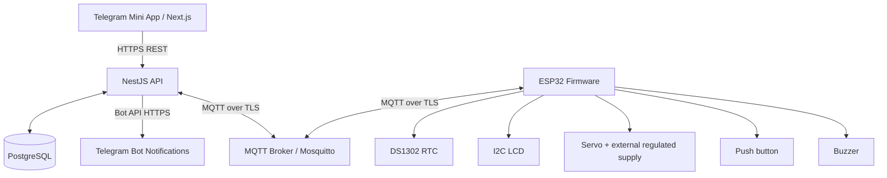

# Smart Pet Feeder — System Design & Requirements

**Status:** Revised MVP specification — DS1302 confirmed; no load cell; MQTT hosting undecided

## 1. Overview and scope
A Wi-Fi-connected, ESP32-based feeder for dry pet food. Owners manage feeding schedules, manually dispense food, review history, and receive alerts using a **Telegram Mini App**. The ESP32 executes saved schedules locally with an RTC when Wi-Fi or the backend is unavailable.

**MVP goals:** safe and repeatable dispensing; configurable schedule and servo-open duration; physical-button and remote feeding; LCD status; buzzer alerts; Telegram notifications; reliable offline scheduling; feeding logs.

**Out of scope for MVP:** camera, multi-pet recognition, automatic nutritional recommendations, remote firmware updates. Weight-based verification is out of scope. The system reports servo actuation, not verified food delivery.

## 2. Feature requirements
| Feature | Priority | Acceptance / behavior |
|---|---|---|
| Telegram Mini App | Must | Next.js UI opened from Telegram; authenticated through backend-validated Telegram init data |
| Scheduled feeding | Must | Create/edit/disable multiple daily feed times; ESP32 stores active schedule in persistent storage |
| Servo-open timer | Must | Set calibrated open duration in milliseconds, within firmware-enforced safety limits; servo closes automatically |
| Manual feed in app | Must | Explicit action sends unique command; app displays pending, succeeded, failed, or unknown status |
| Physical button | Must | Debounced press initiates a bounded feed when allowed |
| LCD | Must | Show current time, next feed, connectivity, feeding/error state |
| Buzzer | Must | Configurable short alert for feeding and distinct error alert; optional mute |
| Telegram notifications | Must | Report completed/failed feed and important alerts via bot; prevent duplicate notifications |
| Feeding history | Must | Store time, source, schedule/command ID, duration, and servo actuation status; no measured grams |
| Device status | Must | Last-seen timestamp, online/offline, firmware version, last feed, RTC validity |
| Feed safety limits | Must | Maximum duration, cooldown, daily cap, no concurrent dispensing, close gate on errors/reboot |
| Offline feeding | Must | RTC + persisted schedule work without internet; local events queued for later upload |
| Portion presets | Should | Small/medium/large map to tested duration values, not assumed grams |
| Time-based calibration | Should | Test several servo-open durations and manually measure dispensed food with an external scale; store recommended durations only |
| Low-food detection | Future | Requires an additional suitable sensor; not available in MVP |
| Jam detection | Future | Requires suitable sensing/feedback; not available in MVP |
| Wi-Fi provisioning | Should | Set/change credentials using a secure provisioning process |
| Multiple feeders / pet profiles | Future | Per-user device access and profiles |
| OTA firmware | Future | Signed firmware updates with rollback plan |

**Safety note:** The servo timer controls gate-open duration, not food mass. Never label it as grams without calibration and measurement. An ESP32 command acknowledgement does not prove food physically dropped.

## 3. Architecture

The **NestJS backend** is the only application component that publishes commands to the broker; the Mini App never connects directly to MQTT. The ESP32 is authoritative for physical execution and local offline schedule execution. PostgreSQL stores the authoritative desired configuration and cloud history; firmware keeps an applied local copy.

## 4. Hardware bill of materials
| Component | Purpose | Status / notes |
|---|---|---|
| ESP32 development board | Wi-Fi, logic, MQTT | Required |
| SG90 9g servo | Opens/closes food gate | Required for prototype; torque and load need testing |
| Physical push button | Local manual dispense | Required; GPIO with pull-up and debounce |
| DS1302 RTC module + backup battery | Offline timekeeping | Required; 3-wire DAT/CLK/RST interface; validate logic-level compatibility |
| 16x2 I2C LCD | Local status | Required; check module logic-voltage compatibility |
| Buzzer | Sound notifications | Required; driver/transistor if current exceeds GPIO rating |
| Regulated 5V servo supply | Motor power | Required; adequate current, common ground with ESP32 |
| ESP32 power supply | Controller power | Required; USB/regulated input per board specifications |
| Food hopper and flap | Food storage / gate | Required; food-safe construction and secure lid |
| LED | Quick status indication | Optional |
| Enclosure and strain relief | Electrical/mechanical safety | Required |

**Power rule:** Do not connect a servo directly to a 9V battery or assume ESP32 3.3V can power it. Use a regulated supply matching the servo rating; share ground between servo supply and ESP32. Check LCD I2C voltage/level shifting. Verify pin allocation and avoid ESP32 boot-strapping pin conflicts.

### 4.1 Suggested ESP32 wiring (verify board pinout and module voltage)
| Peripheral | ESP32 pin | Voltage / notes |
|---|---|---|
| Servo signal | GPIO 4 | External regulated servo power; common ground (moved from 18 to free pin for RTC CLK) |
| Button | GPIO 27 | Input pull-up; switch to GND; debounce in firmware |
| Buzzer signal | GPIO 25 | Use transistor/driver if necessary |
| LCD SDA / SCL | GPIO 21 / GPIO 22 | I²C; check voltage and level shifting |
| DS1302 DAT / CLK / RST | GPIO 19 / GPIO 18 / GPIO 5 | ThreeWire interface; check RTC module voltage and logic levels (3.3V recommended) |

## 5. Tech stack and protocols
| Layer | Choice |
|---|---|
| Mini App frontend | Next.js + TypeScript; Telegram Mini Apps JavaScript SDK |
| Backend | NestJS + TypeScript |
| Database | PostgreSQL; migrations via ORM of choice (TBD) |
| Device firmware | ESP32 Arduino framework / C++ (TBD) |
| Device message broker | Eclipse Mosquitto (MQTT) |
| Notifications | Telegram Bot API |
| Deployment | HTTPS reverse proxy, API service, broker, PostgreSQL (hosting TBD) |

| Protocol / interface | Used for |
|---|---|
| Wi-Fi 2.4 GHz | ESP32 connectivity |
| HTTPS / REST | Next.js ↔ NestJS; backend ↔ Telegram Bot API |
| MQTT with TLS | Backend ↔ broker ↔ ESP32 commands, telemetry, events |
| WebSocket / SSE (optional) | Live Mini App status updates; polling is enough for MVP |
| I²C | LCD only |
| 3-wire synchronous serial | DS1302 RTC (DAT, CLK, RST) |
| GPIO / PWM | Button, servo, buzzer |
| NTP | Network time sync; RTC fallback offline |

## 6. MQTT contract (proposed)
Use per-device topics, e.g. `feeders/{deviceId}/...`, rather than a global `feeder/...` namespace.

| Topic suffix | Publisher → subscriber | Purpose |
|---|---|---|
| `cmd/feed` | Backend → ESP32 | Manual feed with `commandId`, `durationMs`, `expiresAt` |
| `cmd/sync` | Backend → ESP32 | Request config/state refresh |
| `config/desired` | Backend → ESP32 | Versioned schedule, timezone, durations, alert settings |
| `config/reported` | ESP32 → Backend | Applied config version and validation result |
| `event/feed` | ESP32 → Backend | Event ID, source, timestamps, status, duration, no measured weight |
| `state` | ESP32 → Backend | Device state, next feed, last seen, RTC validity |
| `alert` | ESP32 → Backend | Jam, low food, RTC invalid, power recovery |
| `availability` | ESP32 LWT / ESP32 → Backend | Offline/online broker presence |

Example manual command:
```json
{"commandId":"uuid","durationMs":800,"expiresAt":"2026-10-13T15:00:30Z"}
```
Example feed event:
```json
{"eventId":"uuid","commandId":"uuid-or-null","scheduleId":"id-or-null","source":"manual_app","status":"completed","startedAt":"2026-10-13T15:00:01Z","durationMs":800,"dispensedGrams":null}
```
**Delivery policy:** MQTT QoS 1 for commands/events, persistent event IDs and deduplication, no retained `cmd/feed`, retained versioned desired configuration, device-specific credentials/ACLs, last-will offline message. Reconnect with backoff. ESP32 checks expiration and bounds before execution. MQTT delivery can duplicate messages; never dispense twice for the same `commandId`.

## 7. Feeding workflows
### 7.1 Scheduled feeding
1. Owner creates a schedule in Mini App; NestJS validates it and writes to PostgreSQL.
2. Backend publishes a versioned desired schedule over MQTT.
3. ESP32 validates and saves it in nonvolatile storage, then reports applied version.
4. ESP32 checks RTC and triggers due feed **once per schedule occurrence**, including after reboot.
5. Servo opens for configured duration, closes, and ESP32 records the outcome locally.
6. When online, ESP32 publishes an event; NestJS deduplicates, stores history, and sends Telegram notification.

### 7.2 Manual feeding
1. Owner taps Feed Now (or presses physical button).
2. Backend authenticates Telegram user, checks device access, validates limits, and creates command ID.
3. For app-triggered feed, backend publishes a short-lived MQTT command; button feed is handled locally.
4. ESP32 checks limits, prevents concurrent feeds, operates servo, and emits result.
5. Backend updates command state and history; Mini App shows confirmed result. Timeout means **unknown**, not automatically failed or safe to retry.

### 7.3 Offline and restart handling
- RTC runs on backup battery; schedule and recent execution IDs persist on ESP32.
- No Wi-Fi: local schedule and button remain available; remote control and Telegram notification do not.
- On reconnect: upload queued events, sync desired configuration, and reconcile version conflicts.
- After restart: servo defaults to closed, validate RTC, do not blindly replay missed feed times. Missed-feed policy: **skip and alert** by default (TBD).
- If RTC is invalid: disable unattended scheduling until valid time restored; show error on LCD.

## 8. Firmware state machine
`BOOT → SELF_TEST → IDLE → VALIDATE_TRIGGER → DISPENSING → CLOSE_GATE → RECORD_EVENT → IDLE`

Error transitions: `INVALID_TIME`, `LIMIT_REACHED`, `ACTUATION_TIMEOUT`, `NETWORK_OFFLINE`. No load cell or motor feedback is installed: do not infer jam or successful food delivery from a completed servo command. Stop safely on firmware-detectable faults and report actuation only; do not automatically retry an uncertain dispense.

## 9. Data model (proposed)
| Table | Key fields |
|---|---|
| `users` | `id`, `telegram_user_id` (unique), `display_name`, `created_at` |
| `devices` | `id`, `name`, `owner_id`, `last_seen_at`, `firmware_version`, `timezone`, `config_version` |
| `device_access` | `device_id`, `user_id`, `role` (future multi-user) |
| `feeding_schedules` | `id`, `device_id`, `time_local`, `days_of_week`, `duration_ms`, `enabled`, `version` |
| `feed_commands` | `id`, `device_id`, `requested_by`, `duration_ms`, `status`, `expires_at`, `created_at` |
| `feeding_events` | `id`, `device_id`, `command_id`, `schedule_id`, `source`, `status`, `started_at`, `duration_ms`, `actuation_completed` |
| `device_settings` | `device_id`, `default_duration_ms`, `max_duration_ms`, `cooldown_seconds`, `buzzer_enabled`, `max_feeds_per_day` |
| `device_alerts` | `id`, `device_id`, `type`, `severity`, `created_at`, `resolved_at` |
| `notification_deliveries` | `id`, `event_id`, `telegram_chat_id`, `status`, `sent_at` |

Enforce unique event IDs and command IDs. Distinguish requested feed, accepted command, servo actuation, and verified food dispense.

## 10. Suggested REST API
| Method | Route | Purpose |
|---|---|---|
| `POST` | `/auth/telegram` | Validate Telegram init data and establish session |
| `GET` | `/devices` | List devices accessible to user |
| `GET` | `/devices/:id/status` | Get last known state |
| `POST` | `/devices/:id/feed` | Request bounded manual feed |
| `GET` | `/devices/:id/feeding-events` | Feeding history |
| `GET/POST` | `/devices/:id/schedules` | List/create schedules |
| `PATCH/DELETE` | `/devices/:id/schedules/:scheduleId` | Edit/remove schedule |
| `GET/PATCH` | `/devices/:id/settings` | Get/update servo/buzzer/limits |
| `GET` | `/devices/:id/alerts` | View alerts |

Every device route checks user ownership/access. Validate Telegram `initData` on the NestJS server; never trust `initDataUnsafe` or client-supplied Telegram user IDs as proof of identity.

## 11. Mini App screens
1. **Home:** device connectivity, next feed, last feed, Feed Now, error banner.
2. **Schedules:** daily/weekly schedule list; add/edit/enable/disable.
3. **Manual feed:** duration preset/custom within limits; confirmation and command result.
4. **History:** feeding source, time, duration, status, servo actuation status.
5. **Settings:** device name, timezone, default duration, buzzer, notification preferences, calibration.
6. **Alerts:** offline, actuation timeout, invalid RTC.

## 12. Notifications and local UI
- Telegram bot messages: feed completed/failed, failed actuation, prolonged offline, invalid RTC.
- Telegram Mini App is the interface; bot messaging requires that the user has started/authorized the bot as needed.
- LCD screens: idle clock/next feed; dispensing countdown; success/error; Wi-Fi/RTC state.
- Buzzer: optional pre-feed chirp and error pattern; allow muting and quiet hours.

## 13. Security, reliability, and safety
- HTTPS for API; TLS and device-specific MQTT credentials/ACLs; keep secrets out of source control.
- Validate Telegram Mini App identity on server; authorize each device operation.
- Bound servo duration and feeding frequency in **firmware**, not only UI/backend.
- Prevent simultaneous feeding; debounce button; deduplicate MQTT commands and events.
- Keep a safe closed-gate default; watchdog/restart handling; log power recovery.
- Preserve schedules and execution markers across restart; validate RTC time and timezone/DST policy.
- Keep food-contact materials cleanable; prevent pet access to moving parts and wiring.
- Test servo current draw with a separate regulated power supply and common ground.
- Never claim weight, low food, or jam detection without the corresponding sensor and calibration.

## 14. Test plan and acceptance criteria
| Test | Expected result |
|---|---|
| Schedule with internet | Dispenses once at scheduled time and records event |
| Schedule without Wi-Fi | Still dispenses once using RTC and local schedule |
| Reboot near schedule time | No accidental double feed |
| App Feed Now | One command → at most one dispense; UI shows eventual outcome |
| Duplicate MQTT command | No second dispense for same command ID |
| Expired MQTT command | Ignored and logged |
| Button bounce / rapid presses | Debounced; cooldown/limits enforced |
| Duration outside allowed range | Rejected by backend and firmware |
| Servo power test | No ESP32 brownout or LCD corruption |
| Invalid RTC | Scheduled feeding paused; clear warning shown |
| Broker reconnect | Pending events replayed without duplicate database records |
| No load cell installed | History reports actuation, never measured grams or verified food delivery |

## 15. Implementation roadmap
| Phase | Deliverables |
|---|---|
| 1 — Hardware proof of concept | ESP32 + servo + RTC + LCD + button + buzzer; stable power; local feeding |
| 2 — Firmware reliability | Persistent schedules, safety limits, RTC recovery, local event queue |
| 3 — Cloud connectivity | Mosquitto MQTT topics, NestJS consumer/publisher, PostgreSQL logging |
| 4 — Telegram experience | Bot setup, Next.js Mini App, Telegram authentication, schedule/manual/history UI, notifications |
| 5 — Validation | Offline/restart tests, duplicate commands, power tests, demo |
| 6 — Optional upgrades | Add suitable sensors for low-food/jam detection, OTA |

## 16. Confirmed decisions and remaining questions
**Confirmed:** DS1302 RTC (DAT/CLK/RST); SG90 servo flap; no load cell or HX711; time-based dispensing; Telegram Mini App + NestJS + PostgreSQL; MQTT transport.

**Still to confirm:** exact ESP32 board; SG90 gate geometry and calibrated minimum/maximum duration; LCD I²C voltage compatibility; buzzer type; physical power supply; device pairing/provisioning; MQTT deployment; hosting budget; missed-feed policy (default: skip and notify); timezone (default: `Asia/Phnom_Penh`).

## 17. MQTT deployment options (decision deferred)
| Option | Layout | Pros | Limitations |
|---|---|---|---|
| Local LAN | ESP32 and Mosquitto on same LAN; NestJS on LAN | Simple development, works without public internet for local messaging | Remote Telegram control needs a secure bridge or reachable backend; home power/network dependency |
| Cloud VPS | ESP32 connects outbound to cloud Mosquitto; NestJS and PostgreSQL hosted | Supports remote Mini App control from anywhere | Requires TLS, credentials, hosting, and internet for remote actions |
| Hybrid | Local broker + secured bridge to cloud services | Local responsiveness plus remote access | More operational complexity and duplicate/event reconciliation |

**MVP recommendation:** Build and test with a local Mosquitto broker first, but configure `MQTT_HOST`, `MQTT_PORT`, TLS, credentials, and per-device topic prefix via environment/configuration so moving to cloud does not require changing business logic. Keep offline schedules on ESP32 in every option. Do not expose an unauthenticated broker to the public internet.

## 18. Revised implementation plan
1. **Hardware:** ESP32 + SG90 servo (external regulated supply), DS1302 (with backup battery), 16×2 I²C LCD, button, buzzer; verify all pin and voltage compatibility.
2. **Local firmware:** DS1302 time read/validation, LCD time and next feed, button-triggered servo actuation, buzzer, configurable duration with hard safety maximum and cooldown.
3. **Offline scheduling:** persist schedules and executed-occurrence identifiers in ESP32 nonvolatile storage; use RTC to execute once, including across restarts; skip missed feeds by default.
4. **MQTT integration:** local broker for development; per-device topics, QoS 1, command expiry, idempotency, status/events, reconnect, and broker availability.
5. **Backend/database:** NestJS validates Telegram identity and device ownership; PostgreSQL stores desired schedules, command records, actuation events, and alerts.
6. **Telegram Mini App:** Next.js screens for Feed Now, schedule editor, configurable servo duration, history, device status, settings; bot notifications.
7. **Verification:** test duplicate MQTT messages, offline schedules, RTC backup, servo current/brownout, restart behavior, command expiry, safety limits, and manually calibrated output amounts.

## 19. Scope and terminology
- A **successful actuation** means firmware completed the commanded servo movement. It does **not** verify food dropped.
- **Duration (ms)** is the controlled quantity. Small/medium/large presets are experimentally chosen durations, not guaranteed grams.
- No hopper level, food mass, jam detection, or food-consumption tracking is available without additional hardware.
- The DS1302 is a 3-wire RTC; the LCD is I²C. They do not share the same bus.
- RTC backup battery preserves time during power loss, but cannot run the feeder motor; scheduled dispensing resumes only when main power returns.

## 20. MQTT learning and remote-prototype strategy (updated)

**Decision:** Use two environments with the same device topic contract: (A) **local Eclipse Mosquitto in Docker** for hands-on learning and (B) a **managed cloud MQTT broker** for an internet-accessible prototype. Hosting vendor and long-term budget remain undecided. HiveMQ Cloud is one candidate; check its current trial/pricing and connection limits before selecting it. Self-hosted Mosquitto on a VPS is a later alternative, not the first learning step.

**Architecture:** Telegram Mini App (Next.js) → HTTPS → NestJS API (Telegram init-data verification, authorization, command tracking) → MQTT broker (local or cloud) → ESP32. ESP32 publishes status, actuation events, and alerts through MQTT to NestJS, which persists them in PostgreSQL and sends Telegram bot notifications. The Mini App does **not** connect directly to MQTT or hold broker credentials. Offline feeding is handled by DS1302 + ESP32-persisted schedules independently of MQTT availability.

### 20.1 Hands-on learning labs
| Lab | Goal | Exercise | Completion check |
|---|---|---|---|
| 1 — Publish / subscribe | Understand broker-mediated messaging | Run local Mosquitto; subscribe in one terminal; publish from another; inspect with MQTT Explorer | Subscriber receives payload and topic correctly |
| 2 — Topic design | Organize per-device messages | Publish commands, events, configuration, and alerts under `feeder/{deviceId}/...`; test `+` and `#` wildcards | Different devices' traffic stays separate |
| 3 — Authentication and ACL | Prevent unauthorized access | Disable anonymous access; create distinct ESP32 and backend users; restrict read/write topics | Invalid login and forbidden publish are rejected |
| 4 — Delivery semantics | Understand QoS and retain | Test QoS 0/1, retained schedule config, reconnect; demonstrate duplicate QoS 1 delivery | Firmware handles repeated command IDs without repeated feeding |
| 5 — Disconnection handling | Recover safely | Stop broker, disconnect Wi-Fi, reboot ESP32; configure Last Will, keepalive, reconnect backoff, offline RTC schedules | Offline feeding continues and availability recovers on reconnect |
| 6 — Remote prototype | Connect across networks | Configure managed broker with TLS; connect ESP32 over Wi-Fi and NestJS over internet; invoke feed from Mini App on mobile data | Remote command receives an actuation-result event |

### 20.2 Local Mosquitto setup (development only)

Create a `mosquitto/config/mosquitto.conf` file and a `compose.yaml` in your MQTT lab directory. The following anonymous listener is **only** for the initial local lab; do not expose port 1883 to the internet or use it in the remote prototype.

`mosquitto/config/mosquitto.conf`:
```conf
listener 1883 0.0.0.0
allow_anonymous true
persistence true
persistence_location /mosquitto/data/
log_dest stdout
```

`compose.yaml`:
```yaml
services:
  mosquitto:
    image: eclipse-mosquitto:2
    container_name: mosquitto
    restart: unless-stopped
    ports:
      - "1883:1883"
    volumes:
      - ./mosquitto/config:/mosquitto/config
      - ./mosquitto/data:/mosquitto/data
```

Start with `docker compose up -d`. In separate terminals:
```bash
docker exec -it mosquitto mosquitto_sub -h localhost -t 'feeder/test' -v
docker exec mosquitto mosquitto_pub -h localhost -t 'feeder/test' -m 'Hello ESP32'
```

For ESP32 testing on the same Wi-Fi, use the computer's LAN IP (not `localhost`), permit only necessary local firewall access, and ensure Wi-Fi client isolation is disabled. Next, replace anonymous access with a Mosquitto password file and ACL before connecting real devices. Keep password files out of source control; use different credentials per client. For a remote broker, require TLS and broker-side topic authorization.

### 20.3 MQTT topic contract and delivery policy
| Topic | Publisher → Subscriber | QoS | Retained | Notes |
|---|---|---:|---|---|
| `feeder/{id}/cmd/feed` | NestJS → ESP32 | 1 | No | Include unique `commandId`, `durationMs`, `expiresAt`; reject stale/duplicate commands |
| `feeder/{id}/config/schedule` | NestJS → ESP32 | 1 | Yes | Versioned desired schedule; validate then persist locally and acknowledge version |
| `feeder/{id}/status/availability` | ESP32 / broker LWT → NestJS | 1 | Yes | ESP32 publishes `online`; broker Last Will publishes `offline` on unexpected disconnect |
| `feeder/{id}/status/heartbeat` | ESP32 → NestJS | 0 | No | Timestamp, firmware, RTC validity; backend calculates last-seen |
| `feeder/{id}/event/feeding` | ESP32 → NestJS | 1 | No | Command/schedule ID, source, actuation outcome, timestamp; no weight claim |
| `feeder/{id}/event/config_ack` | ESP32 → NestJS | 1 | No | Applied schedule version or validation failure |
| `feeder/{id}/alert/error` | ESP32 → NestJS | 1 | No | RTC error, servo control failure, rejected command, etc. |

**Example command:**
```json
{
  "commandId": "b7d8a6e0-1b1d-4a56-92fd-40bbecb193aa",
  "durationMs": 700,
  "issuedAt": "2026-10-13T14:00:00Z",
  "expiresAt": "2026-10-13T14:00:15Z"
}
```
The duration above is illustrative, **not** a recommended servo timing; calibrate the mechanism and enforce hard firmware bounds. Commands must never be retained. ESP32 should persist recently executed command IDs and schedule-occurrence IDs to avoid accidental double feeding after a reboot or reconnect. Expired commands are rejected only when the device has a valid time source; otherwise fail closed for remote feed commands.

### 20.4 Disconnected-device rules
1. **Wi-Fi/broker loss:** local DS1302 schedule and button remain operational, subject to safety rules; queue bounded actuation events in persistent storage for later reconciliation.
2. **Unexpected disconnect:** MQTT Last Will marks availability offline; backend also uses heartbeat timeouts because LWT delivery may be delayed or unavailable during wider outages.
3. **Reconnection:** use backoff with jitter, resubscribe, reconcile desired schedule version, and upload queued events; do not automatically execute missed remote feed commands.
4. **Duplicate delivery:** MQTT QoS 1 may redeliver; command and event handlers must be idempotent.
5. **Power loss:** RTC backup maintains clock only; servo cannot feed without primary power. Default policy is to skip missed schedules, record/report missed occurrences where determinable, and never automatically catch up with multiple feeds.
6. **Safety:** maximum duration, cooldown, daily limit, and one active actuation at a time are enforced on ESP32 even if backend is unreachable.

### 20.5 Remote prototype rollout
1. Complete local labs and establish a tested MQTT topic/payload contract.
2. Select a managed broker plan after verifying current pricing, TLS support, credentials, ACLs, and connection quotas.
3. Create separate ESP32 and NestJS credentials; configure CA trust, unique client IDs, and per-device topic access. Do not place MQTT secrets in the Telegram Mini App.
4. Parameterize `MQTT_HOST`, `MQTT_PORT`, `MQTT_TLS`, `MQTT_USERNAME`, `MQTT_PASSWORD`, `MQTT_CLIENT_ID`, and `MQTT_TOPIC_PREFIX` in backend/device configuration.
5. Host the NestJS API and Next.js Mini App on reachable HTTPS endpoints; host PostgreSQL with appropriate access restrictions. MQTT cloud hosting alone does not deploy these services.
6. Test on **mobile data**: open Telegram Mini App → Feed Now → backend authorization → publish → ESP32 actuation → event → PostgreSQL history → Telegram notification.
7. Repeat with internet interruptions and verify that local scheduled feeding still works.

**Revised milestone order:** Hardware basics → offline RTC scheduling → local MQTT labs → secured MQTT → managed-cloud broker connection → NestJS/PostgreSQL integration → Telegram Mini App → resilience/security tests.
